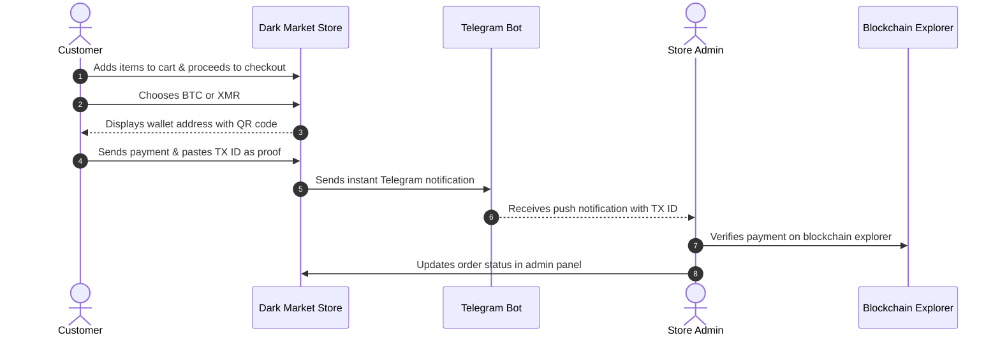

# SHADOW MARKET

```text
███████╗██╗  ██╗ █████╗ ██████╗  ██████╗ ██╗    ██╗    ███╗   ███╗ █████╗ ██████╗ ██╗  ██╗███████╗████████╗
██╔════╝██║  ██║██╔══██╗██╔══██╗██╔═══██╗██║    ██║    ████╗ ████║██╔══██╗██╔══██╗██║ ██╔╝██╔════╝╚══██╔══╝
███████╗███████║███████║██║  ██║██║   ██║██║ █╗ ██║    ██╔████╔██║███████║██████╔╝█████╔╝ █████╗     ██║   
╚════██║██╔══██║██╔══██║██║  ██║██║   ██║██║███╗██║    ██║╚██╔╝██║██╔══██║██╔══██╗██╔═██╗ ██╔══╝     ██║   
███████║██║  ██║██║  ██║██████╔╝╚██████╔╝╚███╔███╔╝    ██║ ╚═╝ ██║██║  ██║██║  ██║██║  ██╗███████╗   ██║   
╚══════╝╚═╝  ╚═╝╚═╝  ╚═╝╚═════╝  ╚═════╝  ╚══╝╚══╝     ╚═╝     ╚═╝╚═╝  ╚═╝╚═╝  ╚═╝╚═╝  ╚═╝╚══════╝   ╚═╝   
```

> **A lightweight, privacy-first crypto e-commerce Flask application with a darknet aesthetic, native Tor hidden service integration, and automated Telegram order notifications.**

---

### Features

- 🕵️ **Zero Registration & Frictionless Privacy** — No customer accounts, passwords, or tracking cookies. Orders are identified solely by unique order IDs.
- 💰 **Crypto Only (BTC & XMR)** — Direct manual proof-based payments using Bitcoin (BTC) and Monero (XMR) wallet addresses with dynamic QR codes.
- 📡 **Instant Telegram Alerts** — Instant push notifications delivered to your private Telegram chat whenever a customer places an order.
- 🔐 **Protected Admin Dashboard** — Clean, password-secured interface to review incoming payments, inspect blockchain TX IDs, and update fulfillment statuses.
- 🧅 **Tor Hidden Service Ready** — Architectural design specifically tuned for `.onion` hidden service deployment with local loopback binding.
- 🎨 **Terminal Cyberpunk Aesthetic** — Neon-on-dark high-contrast retro styling built with lightweight vanilla CSS and zero heavy JavaScript dependencies.
- 🗄️ **Self-Contained SQLite Storage** — Zero external database daemon dependencies; persists catalog and order state cleanly in a portable SQLite database.

---

## 2. Quick Start

```bash
# Clone or download
cd darkmarket

# Create virtual environment
python -m venv venv
source venv/bin/activate  # Linux/Mac
# or: venv\Scripts\activate  # Windows

# Install dependencies
pip install -r requirements.txt

# Copy and configure environment
cp .env.example .env
# Edit .env with your wallet addresses, telegram bot token, and admin password

# Seed the database with sample products
python seed_data.py

# Run development server
python app.py
# Visit http://127.0.0.1:5000
```

---

## 3. Configuration

All configuration is managed through environment variables loaded from the `.env` file in the project root:

| Variable | Required | Default | Description |
| :--- | :---: | :---: | :--- |
| `BTC_WALLET_ADDRESS` | **Yes** | — | Your Bitcoin receiving address |
| `XMR_WALLET_ADDRESS` | **Yes** | — | Your Monero receiving address |
| `TELEGRAM_BOT_TOKEN` | Optional | — | From [@BotFather](https://t.me/BotFather) |
| `TELEGRAM_CHAT_ID` | Optional | — | Your personal chat ID |
| `ADMIN_PASSWORD` | **Yes** | `admin` | Password for `/admin` panel |
| `SECRET_KEY` | Optional | *Auto-generated* | Flask secret key (auto-generated if not set) |
| `SITE_NAME` | Optional | `SHADOW MARKET` | Your store name (default: SHADOW MARKET) |

---

## 4. Setting Up Telegram Notifications

Step-by-step:
1. Open Telegram, search **[@BotFather](https://t.me/BotFather)**.
2. Send `/newbot`, follow prompts.
3. Copy the API token → put in `.env` as `TELEGRAM_BOT_TOKEN`.
4. Start a chat with your new bot.
5. Visit `https://api.telegram.org/bot<TOKEN>/getUpdates` (replace `<TOKEN>` with your bot token).
6. Find your `chat_id` in the response → put in `.env` as `TELEGRAM_CHAT_ID`.

---

## 5. Deploying as a Tor Hidden Service

#### Prerequisites
- A Linux VPS (Ubuntu 22.04+ recommended)
- Python 3.10+
- Tor installed

#### Step-by-step:

```bash
# 1. Install Tor
sudo apt update
sudo apt install tor

# 2. Configure Tor hidden service
sudo nano /etc/tor/torrc
# Add these lines:
#   HiddenServiceDir /var/lib/tor/darkmarket/
#   HiddenServicePort 80 127.0.0.1:5000

# 3. Restart Tor
sudo systemctl restart tor

# 4. Get your .onion address
sudo cat /var/lib/tor/darkmarket/hostname
# This is your .onion URL!

# 5. Run the app with Gunicorn (production)
gunicorn -c gunicorn_config.py app:app

# 6. (Optional) Create a systemd service for auto-start
sudo nano /etc/systemd/system/darkmarket.service
```

Include the systemd service file content:

```ini
[Unit]
Description=Dark Market Flask App
After=network.target tor.service

[Service]
User=www-data
WorkingDirectory=/path/to/darkmarket
EnvironmentFile=/path/to/darkmarket/.env
ExecStart=/path/to/darkmarket/venv/bin/gunicorn -c gunicorn_config.py app:app
Restart=always

[Install]
WantedBy=multi-user.target
```

Then:
```bash
sudo systemctl enable darkmarket
sudo systemctl start darkmarket
```

---

## 6. Admin Panel

- **Access at `/admin`**: Navigate to `http://127.0.0.1:5000/admin` or `http://your-onion-address.onion/admin`
- **Authentication**: Enter password (from `.env` `ADMIN_PASSWORD`)
- **Order Management**: View, manage, and update order statuses
- **Status Progression**: Mark orders as confirmed, shipped, completed:
  - `Pending Payment` — Initial order state awaiting transaction confirmation
  - `Confirmed` — Payment verified on blockchain explorer
  - `Shipped` — Goods or digital keys dispatched to customer
  - `Completed` — Order fulfilled and finalized
  - `Cancelled` — Invalid transaction ID or expired order

---

## 7. How Payments Work



1. Customer adds items to cart
2. At checkout, selects BTC or XMR
3. Your wallet address is displayed with QR code
4. Customer sends payment and pastes TX ID as proof
5. You receive Telegram notification
6. You verify payment on blockchain explorer
7. You update order status in admin panel

---

## 8. Security Notes

- **Never reveal your real IP**: Bind services strictly to `127.0.0.1` and never expose ports publicly.
- **Use Tor for all admin access**: Always access the `/admin` portal through the Tor Browser using the `.onion` address.
- **Change default admin password**: Set a strong, unique `ADMIN_PASSWORD` in your production `.env`.
- **Keep Tor and system packages updated**: Regularly run security updates (`apt update && apt upgrade`).
- **Consider using a VPS paid with crypto**: Use privacy-respecting hosting purchased with Monero to prevent identity leakage.
- **Local binding only**: The site only binds to `127.0.0.1`, never expose to public internet directly.

---

## 9. Project Structure

```
darkmarket/
├── app.py                  # Flask application entry point, routes, and controllers
├── config.py               # Environment configuration & settings loader
├── models.py               # Database models (Product, Order, OrderItem)
├── seed_data.py            # Database seeder with sample products
├── gunicorn_config.py      # Production Gunicorn WSGI configuration
├── requirements.txt        # Python package dependencies
├── .env.example            # Environment variables template
├── .env                    # Local environment secrets (ignored by git)
├── static/
│   ├── css/
│   │   └── style.css       # Darknet cyberpunk terminal styling
│   ├── js/
│   │   └── main.js         # Cart operations, QR code generation, client logic
│   └── images/             # Product catalog images and assets
├── templates/
│   ├── base.html           # Base layout template with terminal theme
│   ├── index.html          # Product catalog and storefront
│   ├── product.html        # Product detail view
│   ├── cart.html           # Shopping cart view
│   ├── checkout.html       # Checkout & crypto selection
│   ├── payment.html        # Crypto payment instructions & TX ID submission
│   ├── order_status.html   # Customer order tracking by ID
│   ├── admin_login.html    # Password login screen for admin
│   └── admin.html          # Order management dashboard
└── README.md               # Project documentation
```

---

## 10. License

MIT License

```text
MIT License

Copyright (c) 2026 SHADOW MARKET

Permission is hereby granted, free of charge, to any person obtaining a copy
of this software and associated documentation files (the "Software"), to deal
in the Software without restriction, including without limitation the rights
to use, copy, modify, merge, publish, distribute, sublicense, and/or sell
copies of the Software, and to permit persons to whom the Software is
furnished to do so, subject to the following conditions:

The above copyright notice and this permission notice shall be included in all
copies or substantial portions of the Software.

THE SOFTWARE IS PROVIDED "AS IS", WITHOUT WARRANTY OF ANY KIND, EXPRESS OR
IMPLIED, INCLUDING BUT NOT LIMITED TO THE WARRANTIES OF MERCHANTABILITY,
FITNESS FOR A PARTICULAR PURPOSE AND NONINFRINGEMENT. IN NO EVENT SHALL THE
AUTHORS OR COPYRIGHT HOLDERS BE LIABLE FOR ANY CLAIM, DAMAGES OR OTHER
LIABILITY, WHETHER IN AN ACTION OF CONTRACT, TORT OR OTHERWISE, ARISING FROM,
OUT OF OR IN CONNECTION WITH THE SOFTWARE OR THE USE OR OTHER DEALINGS IN THE
SOFTWARE.
```
